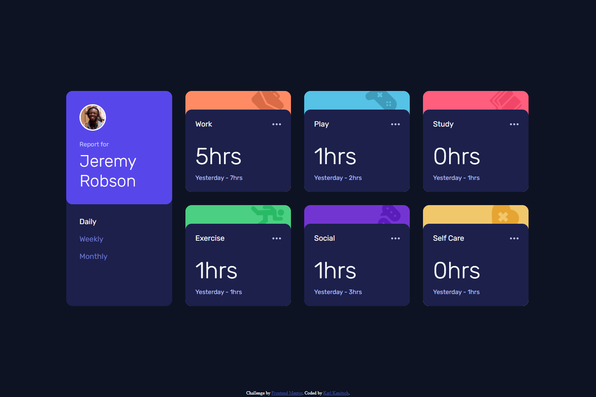
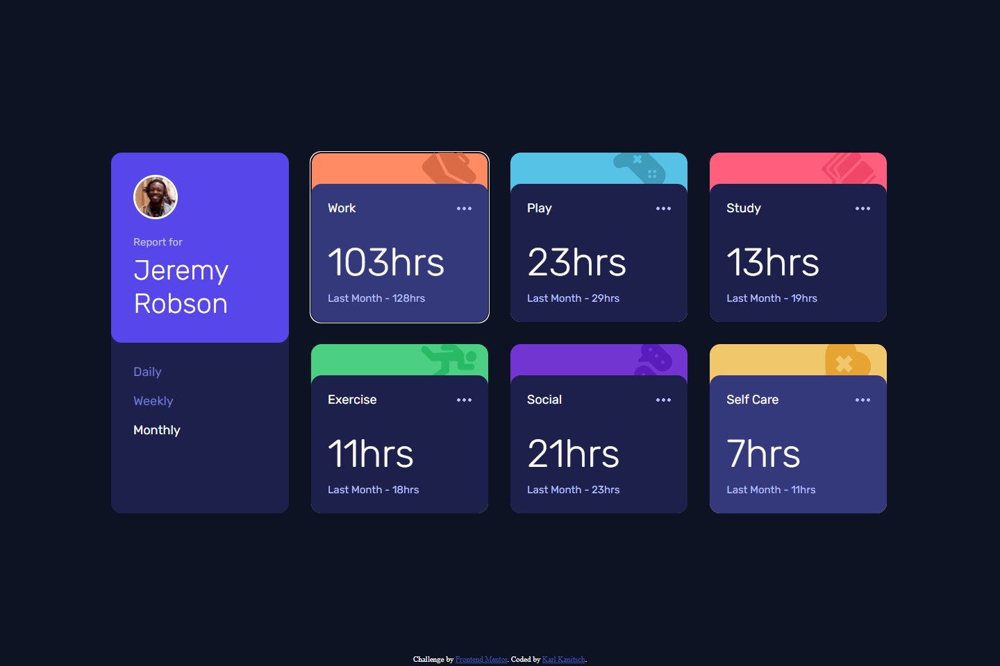
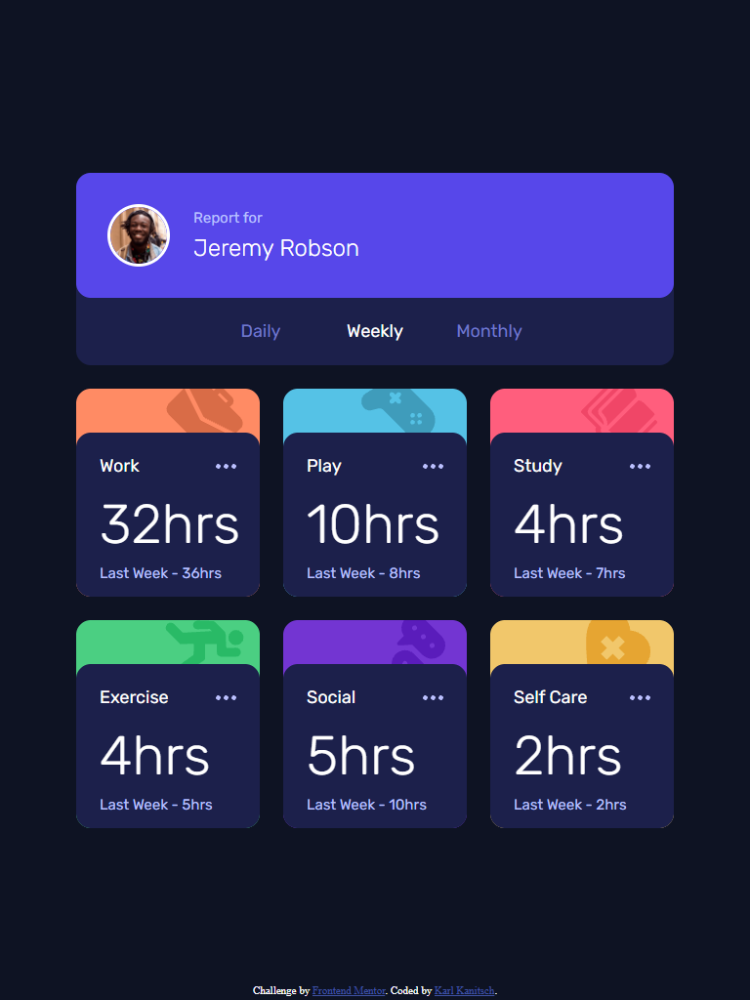
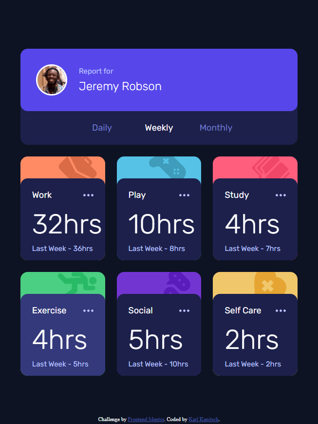
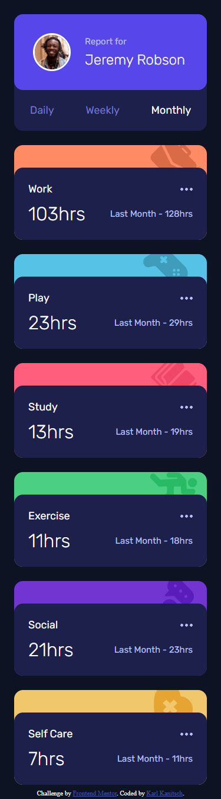
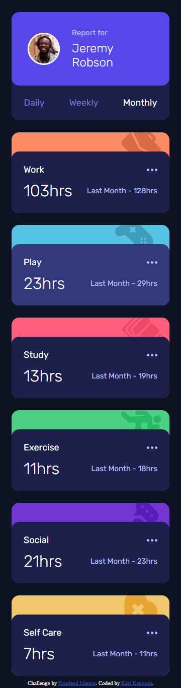

# Frontend Mentor - Time tracking dashboard solution

This is a solution to the [Time tracking dashboard challenge on Frontend Mentor](https://www.frontendmentor.io/challenges/time-tracking-dashboard-UIQ7167Jw). Frontend Mentor challenges help you improve your coding skills by building realistic projects. 

## Table of contents

- [Frontend Mentor - Time tracking dashboard solution](#frontend-mentor---time-tracking-dashboard-solution)
	- [Table of contents](#table-of-contents)
	- [Overview](#overview)
		- [The challenge](#the-challenge)
		- [Screenshot](#screenshot)
		- [Links](#links)
	- [My process](#my-process)
		- [Built with](#built-with)
		- [What I learned](#what-i-learned)
		- [Continued development](#continued-development)
		- [Useful resources](#useful-resources)
	- [Author](#author)

## Overview
This challenge focused mainly on fetching, manipulating, and rendering data on a website. Although it still required responsive layouts and polished styling, it felt simpler than the previous challenge.

The website reads activity data from a JSON file and populates the DOM with it. It also filters the data based on the user’s selected timescale, updating the display whenever that selection changes.

This involved parsing the data, modifying the DOM to render it, and adding event listeners to reparse and rerender the data without fetching it again.

### The challenge

Users should be able to:

- View the optimal layout for the site depending on their device's screen size
- See hover states for all interactive elements on the page
- Switch between viewing Daily, Weekly, and Monthly stats

### Screenshot
- Desktop View 
- Desktop View with Work card focused and Self Care card hovered 
- Tablet View with Weekly timescale 
  
- Tablet View with Exercise card focused
  
- Mobile View with Monthly timescale 
  
- Mobile View with Play card focused  
  


### Links

- Solution URL: [https://github.com/kkanit22/FEM-3-3-time-tracking-dashboard](https://github.com/kkanit22/FEM-3-3-time-tracking-dashboard)
- Live Site URL: [https://kkanit22.github.io/FEM-3-3-time-tracking-dashboard/](https://kkanit22.github.io/FEM-3-3-time-tracking-dashboard/)

## My process

### Built with

- Semantic HTML5 markup
- CSS custom properties
- Flexbox
- Mobile-first workflow

### What I learned

I learned a bit more about processing data, in particular when looping through both arrays and objects, though in this project I only loop through an object (which I convert to an array to allow for iteration). I originally accomplished this using a for ... of loop. I then looked into ways to filter an object by using Object.entries() method to form an array and using the Array.filter() to manipulate the data set and finally creating a new object using Object.fromEntries as shown below:

```js
// We will need the currently selected timescale as a lower case string.
let selectedTimescaleLC = 'daily'; 
// We will also need the data object from the fetch after the promise is resolved.
const data = {}; 
// We can then loop over the data to get the card and the activity data that matches the currently selected timescale.
data.forEach(dataSet) => {
	let activityData = Object.fromEntries(
		Object.entries(dataSet.timeframes).filter(([key, value]) =>
			key.includes(selectedTimescaleLC))
	);

	// Now we can access the filtered data from this dataset:
	populateDOM(dataSet.title, activityData[selectedTimescaleLC]);
}
```

This seems to work fine, at least in snippets I have tested in the developer tools. Nevertheless, I kept my original populateDOM function which uses an inner loop to return the activityData. I will perhaps try something like this in a future challenge or other project, however.

### Continued development

I hope to get more practice with using array functions such as filter and reduce. In particular I hope to get more proficient at converting between objects and arrays and using variable keys when working with objects, like I did above with `activityData[selectedTimescaleLC]`.

### Useful resources

- [Filter object properties by key in ES6](https://stackoverflow.com/questions/38750705/filter-object-properties-by-key-in-es6) - This Stack Overflow discussion included an example of filtering an object by it keys that is similar to what I included in my example above. The biggest difference is that this uses a `.reduce()` method as the filter only includes the keys.
- [JavaScript String Matching Methods](https://dev.to/5t3ph/javascript-string-matching-methods-12f7) - With all of the different ways to compare strings, I found this useful as a way of winnowing down my options and determining which is best suited to the task.

## Author

- Frontend Mentor - [@kkanit22](https://www.frontendmentor.io/profile/kkanit22)